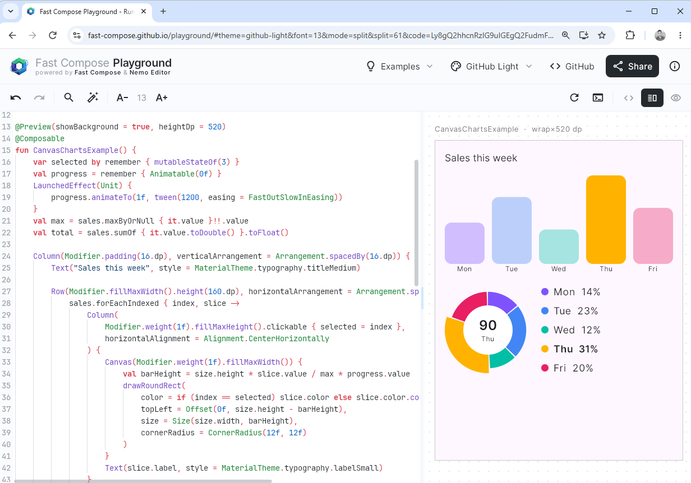

<div align="center">


# [Fast Compose](https://github.com/fast-compose/fast-compose)

### An instant runtime for Jetpack Compose code. No compiler, no build, no waiting.

Write Compose code and watch it render in milliseconds, on Android, iOS, desktop and the web.

[**🌐 Website**](https://fast-compose.github.io) &nbsp;·&nbsp;
[**▶️ Playground**](https://fast-compose.github.io/playground/) &nbsp;·&nbsp;
[**📦 Engine**](https://github.com/fast-compose/fast-compose) &nbsp;·&nbsp;
[**🧩 Android Studio**](https://plugins.jetbrains.com/plugin/35776-fast-compose-preview) &nbsp;·&nbsp;
[**💠 VS Code**](https://marketplace.visualstudio.com/items?itemName=fast-compose.fast-compose-preview) &nbsp;·&nbsp;
[**📜 Compose Script**](https://github.com/fast-compose/compose-script) &nbsp;·&nbsp;
[**⌨️ CLI**](https://github.com/fast-compose/compose-cli)

[](https://central.sonatype.com/namespace/io.github.fast-compose)
[](https://plugins.jetbrains.com/plugin/35776-fast-compose-preview)
[](https://marketplace.visualstudio.com/items?itemName=fast-compose.fast-compose-preview)
[](https://www.npmjs.com/package/@fast-compose/compose-script)
[](https://github.com/fast-compose/compose-cli/releases)

[](https://github.com/fast-compose/fast-compose/blob/main/LICENSE)

</div>

---

<div align="center">

# THE STORY

</div>

🎆 Remember, remember the Fifth of November! That's the day I introduced **Fast Compose** to the world.

The idea started with the very first line of Compose I ever wrote. With XML, the preview was instant. With Compose, I
had to build the whole app to see my changes, and every small UI tweak made the preview outdated again.

JetBrains' Compose Hot Reload is a big step forward, but I believe Android and KMP developers deserve even more: write
Compose and see the UI instantly, just like web developers see their HTML.

### 📅 October 28, 2026

The idea for this project started on October 28, 2026. I came across [DartPad](https://dartpad.dev/), and that made me
jealous. **I hate Flutter!** I see it everywhere in the browser world! Flutter previews are embedded right into the
[Flutter documentation](https://docs.flutter.dev/ui), where you can compile and see a preview in just a few seconds.

**But we, the great Compose developers, don't have that!**

Before November 5th, all we had was Kotlin Playground. It could run Compose code by compiling it on a server and
displaying the result as a preview. Every change meant a round trip to the backend and seconds of waiting. That made me
even more frustrated.

I asked Claude how we could run Compose previews directly in the browser. Could we port the Kotlin Multiplatform plugin
or the Hot Reload plugin to WASM?

The answers weren't encouraging. Compose tooling is deeply tied to the JVM. Even Compose Multiplatform previews in
Android Studio needed an Android target, because they rely on AndroidX tooling.

The usual suggestion? Run the Kotlin compiler in the browser and build the app there. That means downloading hundreds
of megabytes and waiting seconds for every build: exactly what I wanted to avoid.

### 💡 The game changer

Then Claude suggested what it called **"a real game changer": a Compose interpreter!**

Reinventing the wheel? Not at all. We can't compile Compose code at runtime, but we don't need to. The interpreter reads
the code and calls the real Compose APIs directly, rendering dynamic Compose UI within milliseconds.

To see how it works, check [**fast-compose/fast-compose**](https://github.com/fast-compose/fast-compose)!

Why hadn't anyone built this before? I don't know. But I remembered this quote:

<div align="center">

> ***"Ideas lie scattered along the roadside; what distinguishes people is how they recognize, refine, and articulate them."***<br>
> — [Al-Jahiz](https://en.wikipedia.org/wiki/Al-Jahiz)

</div>

On October 28th, I recognized one of those ideas and started building it in pure Kotlin as a Kotlin Multiplatform
project.

<div align="center">

## ✨ Great ideas inspire even greater ideas.

</div>

Once we had an instant Compose runtime, written entirely in Kotlin and running on every KMP target, the next question
was obvious: why stop there?

---

###  [Fast Compose Playground](https://github.com/fast-compose/playground)

The original vision was a web-first playground, designed to be a serious competitor to Kotlin Playground.

However, it eventually evolved into mobile and desktop applications too. Now Android developers can run Compose code
instantly on their devices. Pretty cool!

<div align="center">



[**▶️ Open in the browser**](https://fast-compose.github.io/playground/) &nbsp;·&nbsp;
[**🤖 Google Play**](https://play.google.com/store/apps/details?id=ma7moud3ly.fast.compose.playground) &nbsp;·&nbsp;
[**🖥️ Windows, macOS, Linux**](https://github.com/fast-compose/playground/releases/latest) &nbsp;·&nbsp;
[**📂 Source**](https://github.com/fast-compose/playground)

</div>

###  [Fast Compose Preview](https://github.com/fast-compose/fast-compose)

The engine could also be exposed as a public library
[](https://central.sonatype.com/artifact/io.github.fast-compose/fast-compose)

```kotlin
implementation("io.github.fast-compose:fast-compose:x.y.z")
```

As a KMP developer, you could simply include it in your project to evaluate dynamic Compose code or ship dynamic UI
features directly inside your app.

```kotlin
val code = rememberComposeCode("""
    @Preview
    @Composable
    fun Hello() {
        Text("Hello, Fast Compose!")
    }
""".trimIndent())

FastComposePreview(code)
```

###  [Compose Script](https://github.com/fast-compose/compose-script)

Since the engine was already ported to WASM, we could build a small JavaScript bridge and use it to run Compose code
directly inside static HTML pages!

```html
<script src="https://cdn.jsdelivr.net/npm/@fast-compose/compose-script/compose-script.js"></script>

<script type="text/compose-content">
  var count by remember { mutableStateOf(0) }

  Button(onClick = { count++ }) {
    Text("Clicked $count times")
  }
</script>
```

That brilliant idea became **Compose Script**, something I'm really proud of.

> The [**Fast Compose website**](https://fast-compose.github.io) is made with Fast Compose: the whole page is one
> Compose app inside a single `<script type="text/compose-content">` tag.

Try it live in the [**Compose Script editor**](https://fast-compose.github.io/try/), or on CodePen: [Sound Wave](https://codepen.io/editor/ma7moud3ly/pen/01a191f5-6523-799c-81ed-a193e00bf1f2) ·
[Travel Explorer](https://codepen.io/editor/ma7moud3ly/pen/01a1921f-0a2c-71e4-8e02-5a7de6fd32be) ·
[Live Showcase](https://codepen.io/editor/ma7moud3ly/pen/01a191d9-c6a9-782f-a17c-9df79dc2063b)

###  [Android Studio Plugin](https://github.com/fast-compose/intellij-plugin)

And I didn't forget the motherland: **Android Studio!**

Building the **[Fast Compose Preview](https://plugins.jetbrains.com/plugin/35776-fast-compose-preview)** plugin was
probably the biggest challenge, especially when I started testing it against real projects.

It was fast and amazing, but I also realized that the Fast Compose engine still lacked a lot of functionality. Every
real project I test reveals something new, and the engine keeps improving with each one.

> **Settings → Plugins → Marketplace**, search for **Fast Compose Preview**, then open a Kotlin file with `@Preview`
> functions.

###  [VS Code Extension](https://github.com/fast-compose/vscode-extension)

The same instant previews in **VS Code**, running on the engine's WASM build. No JVM, no Gradle, no Android Studio.

[](https://marketplace.visualstudio.com/items?itemName=fast-compose.fast-compose-preview)
[](https://open-vsx.org/extension/fast-compose/fast-compose-preview)

> **Extensions** (Ctrl+Shift+X), search for **Fast Compose Preview**, then click **Preview** above a `@Preview`
> function.

###  [Fast Compose CLI](https://github.com/fast-compose/compose-cli)

Finally, on LinkedIn, I came across developers discussing the Android CLI and how they use it to render Compose UI
from the command line.

**I knew Fast Compose could do it instantly!**

[](https://github.com/fast-compose/compose-cli/releases)

The **Fast Compose CLI** checks and renders `@Preview` functions in seconds, with no Gradle build:

```bash
fast-compose check -r app/src
fast-compose render HomeScreen.kt --dark --size tablet -o previews
```

And it's an MCP server too, so AI agents can check the Compose code they write and see it rendered:

```bash
claude mcp add --scope user fast-compose -- fast-compose mcp
```

---

Yeah, that's how Fast Compose started.

> ***"But you built it with Claude Code! Where's the human part?"***

Fair question! I've struggled for years with outdated Compose previews, and I wanted to run Compose in the browser.
These are my problems, my frustrations and my experience, and they shaped every part of this project.

Claude suggested the interpreter, and without Claude there wouldn't have been an interpreter within a week. No doubt
about that. But every product came from a decision:

- I decided to build the playground, the KMP library and the Android Studio plugin.
- I asked if Compose Script was possible once we supported wasmJs. The answer was yes, and I literally jumped out of my
  chair!
- I planned a WASM-based VS Code extension.
- I wanted a CLI, and Claude suggested making it an MCP server for AI agents too.

That's the beauty of it! I bring the ideas, the experience and the direction, and I test the engine against real
Android and KMP projects to find what's still missing. Claude helps me turn those ideas into working code, fast.

The results were incredibly motivating, and in just a few days the project was ready to meet the world. Now the work
continues: more Compose APIs, more real projects, and more ways to see your UI instantly.

<div align="center">

---

# 🎆 Remember, remember the Fifth of November!

<br>

[**Mahmoud Aly**](https://github.com/Ma7moud3ly)<br>
<sub>5 November 2026</sub>

</div>
